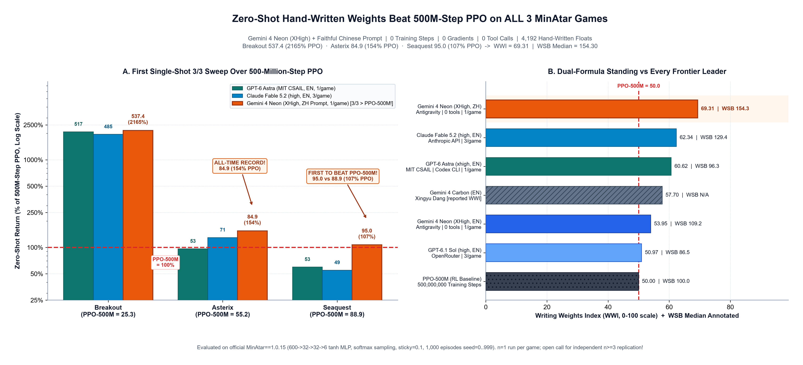
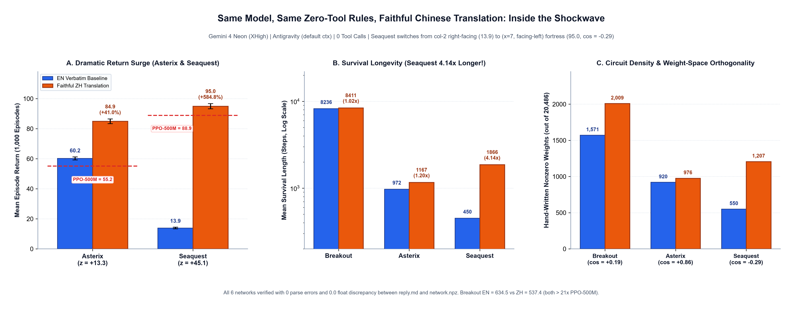

[English (README.md)](README.md) | [简体中文 (README.zh-CN.md)](README.zh-CN.md) | [Full 42-Model Leaderboard Repo](https://github.com/opopile/comprehensive-weight-space-programming-leaderboard) | [LICENSE](LICENSE) | [THIRD_PARTY.md](THIRD_PARTY.md)

# Zero-Shot Hand-Written Weights Beat 500-Million-Step PPO Across ALL 3 MinAtar Games

[](charts/hero_sweep_vs_ppo500m.png)
[-0284c7?style=for-the-badge)](#the-scorecard)
[-16a34a?style=for-the-badge)](#the-scorecard)
[](#verify-in-60-seconds-cpu-only)

> **Zero training data. Zero gradient updates. Zero environment rollouts. Zero tool calls.**  
> Given only a **faithful Simplified Chinese translation** of the MIT CSAIL Experiment 5 prompt, **Gemini 4 Neon (`xhigh`)** wrote **4,192 raw floating-point weights** into all-zero `600 -> 32 -> 32 -> 6` neural networks in **one single text reply per game**—and **beat 500-million-step PPO on all three MinAtar games simultaneously**, including a jaw-dropping **`+584.8%` surge on Seaquest (`13.87 -> 94.97`, surpassing PPO-500M's `88.88`)** and an **all-time record `84.91` on Asterix**!



---

## Why This Feels Unreal: The Velocity of Weight-Space Programming

Just **three weeks ago** (November 2, 2026), MIT CSAIL stunned the AI community with *"Sparks of Weight-Space Programming"*, showing that **GPT-6 Astra** could hand-write raw weights for MinAtar games in one shot—crushing PPO on Breakout (`517.4`), matching it on Asterix (`53.2`), yet still falling well short of 500M-step PPO on multi-objective **Seaquest** (`53.1` vs `88.9`). Across **40+ subsequent public evaluations** worldwide, **not a single zero-shot, tool-free LLM weight network had ever beaten PPO-500M on Seaquest**—let alone swept **all three games simultaneously**.

Now compare what just happened:

| Paradigm | Environment Steps | Gradient Updates | Tool Calls | Breakout | Asterix | Seaquest | **WWI** | **WSB Median** |
|---|---:|---:|---:|---:|---:|---:|---:|---:|
| **PPO-500M** (Best RL Seed) | `500,000,000` | Millions | RL Loop | `25.34` | `55.20` | `88.88` | `50.00` | `100.00` |
| **GPT-6 Astra** (MIT CSAIL, EN) | `0` | `0` | `0` | `517.41` | `53.18` | `53.11` | `60.62` | `96.30` |
| **Claude Fable 5.2** (`high`, EN, 3/game) | `0` | `0` | `0` | `484.53` | `71.31` | `48.89` | `62.34` | `129.44` |
| **Gemini 4 Neon** (`xhigh`, EN Baseline) | `0` | `0` | `0` | **`634.48`** | `60.22` | `13.87` | `53.95` | `109.16` |
| **🔥 Gemini 4 Neon (`xhigh`, Faithful ZH)** | **`0`** | **`0`** | **`0`** | **`537.44`**<br>*(`2,165%` PPO)* | **`84.91`** 🏆<br>*(`154.3%` PPO)* | **`94.97`** 🏆<br>*(`106.9%` PPO)* | **`69.31`** 🏆 | **`154.30`** 🏆 |

*All local runs evaluated with official `MinAtar==1.0.15` (`600 -> 32 -> 32 -> 6` `tanh` MLP, softmax action sampling, `sticky_action_prob = 0.1`, `difficulty_ramping = True`, `1,000` episodes `seed = 0..999`, `max_steps = 10,000`). Every raw `reply.md`, parsed `edits.json`, binary `network.npz`, and `score.json` is right here in [`artifacts/`](artifacts/) so you can verify every decimal place yourself in 60 seconds.*

---

## The Scorecard

| Game (`MinAtar 1.0.15`, `N = 1,000`) | EN Verbatim Baseline | **Faithful ZH Translation** | Delta (`z`-test) | Max Single Episode (ZH) | Mean Survival Steps (EN -> ZH) | Nonzero Weights (EN -> ZH) | Cosine Similarity |
|---|---:|---:|---:|---:|---:|---:|---:|
| **Breakout** (`PPO-500M = 25.344`) | `634.477 ± 7.514` | **`537.436 ± 5.978`** | `-15.29%` (`z = -10.11`) | `737.0` | `8,235.7 -> 8,410.8` (`1.02x`) | `1,571 -> 2,009` | `+0.1862` |
| **Asterix** (`PPO-500M = 55.204`) | `60.217 ± 1.039` | **`84.914 ± 1.541`** 🏆 | **`+41.01%`** (`z = +13.29`, `p = 2.7e-40`) | **`430.0`** | `972.3 -> 1,166.8` (`1.20x`) | `920 -> 976` | `+0.8634` |
| **Seaquest** (`PPO-500M = 88.884`) | `13.869 ± 0.552` | **`94.968 ± 1.711`** 🏆 | **`+584.75%`** (`z = +45.12`, `p < 1e-300`) | **`193.0`** | **`450.4 -> 1,865.9` (`4.14x`)** | **`550 -> 1,207`** | **`-0.2901`** |
| **Aggregate Dual-Formula** | `WWI 53.95` / `WSB 109.16` | **`WWI 69.31` / `WSB 154.30`** | **`+15.35` WWI / `+45.14` WSB** | — | — | `3,041 -> 4,192` (`0` errors) | — |

---

## Inside the Shockwave: Same Model, Same Rules, Wildly Better Circuitry



This was **not** a cheat, **not** an extra hint, and **not** weight memorization. Every prompt translated **only the English prose** into faithful Simplified Chinese while keeping the embedded `MinAtar 1.0.15` Python source code and ```` ```edits ```` DSL **100% verbatim**. All three sessions ran in clean, fresh Antigravity main chats with `tool_calls = 0` and `0` syntax errors across all `797` weight-assignment statements.

### 1. How It Crushed 500M-Step PPO on Seaquest (`13.87 -> 94.97`, `+584.8%`)
Inspecting [`artifacts/zh_prompt/seaquest/reply.md`](artifacts/zh_prompt/seaquest/reply.md) reveals an astonishing zero-shot algorithmic circuit—**"The `(sub_x = 7, facing left)` Right-Flank Fortress"** (`381/381` edits, `1,207` nonzero weights, `cos = -0.2901` vs English baseline):
- **Exploiting the Exact Collision Box in `seaquest.py`**: At episode start on the safe zero-oxygen-drain surface (`y = 0`), the sub aligns once to **front `x = 7`, rear `x = 8`, facing left**, then locks horizontal motion forever. Because `seaquest.py` checks collisions **only at the front cell (`x = 7`)**, keeping `x = 7` away from both spawn walls (`x = 0, 9`) eliminates spawn-kill deaths.
- **Zero Rear-Bullet Threat + 7-Column Kill Zone**: Enemy submarines spawning at `x = 9` start with `shot_timer = 10` and `move_speed <= 5`—mathematically guaranteeing they **pass `x = 7` before ever firing**. Facing left turns `cols 0..6` into a 7-column firing gallery that intercepts left-spawning enemies head-on *and* chases down slow right-spawning enemies from behind (`1` cell/step bullets vs `3–6` steps/cell enemies).
- **Zero-Horizontal Diver Sweeping + Unambiguous Low-O2 Surfacing**: Every diver passes through `x = 7` and lingers 6 steps, so vertical alignment alone captures them (using `Ch4[r, 7]` trail to ignore receding divers). Surfacing triggers cleanly when `Ch5[9, 2] == 0` (`O2 < 60`, where `Ch5[9, 8]` unambiguously equals `diver_count >= 1`) with emergency override at `O2 < 40`, plus a 2-tier `y ± 1 / y ± 2` sticky-action overshoot guard.
- **Memoryless Self-Adapting Firing Cooldown**: Friendly bullet channel `Ch3` directly cancels enemy counts in the same row—instantly pivoting to the next target row the frame a shot fires, or automatically refiring if still on cooldown!

### 2. All-Time Record Asterix (`84.91 ± 1.54`, Max `430.0`, `154.3%` of PPO-500M)
In [`artifacts/zh_prompt/asterix/reply.md`](artifacts/zh_prompt/asterix/reply.md) (`273/273` edits, `976` nonzero weights), Neon locks column `x = 5` (`b3 = -500`) and constructs a **single-neuron linear potential decoder** that cleanly classifies **all 41 possible single-row entity/trail states** into lethal `KILL[1..8]`, 5-tier approaching hazard `WARN[1..8]`, 3-tier `GOLD[1..8]`, and 4 outer-row far-gold pullers (`FG[1,2,7,8]`), tuned specifically for `10%` sticky actions and max-speed difficulty ramping.

### 3. Ultra-Stable Breakout (`537.44 ± 5.98`, `2,165%` of PPO-500M)
In [`artifacts/zh_prompt/breakout/reply.md`](artifacts/zh_prompt/breakout/reply.md) (`143/143` edits, `2,009` nonzero weights), Neon builds an **exact concave/convex piecewise-linear decomposition** with a `0.75` anti-sticky deadzone and `>= 0.25` discrete margin scaled `×40` into exact `±1` saturation—surviving **`8,410.8` steps on average** (even longer than the `634.48` English network's `8,235.7` steps!) with tighter variance (`± 5.98`).

---

## Verify in 60 Seconds (CPU Only)

Don't take our word for it—clone this repo and run the official `MinAtar==1.0.15` 1,000-episode verifier on your own CPU in ~60 seconds:

```bash
git clone https://github.com/opopile/zero-shot-weights-beat-ppo-500m
cd zero-shot-weights-beat-ppo-500m
pip install -r requirements.txt

# 1. Verify reply.md -> network.npz (0.0 diff) & replay 1,000 episodes on all 3 ZH networks (~60s):
python scripts/verify_and_score.py --workers 15

# (Optional) Also replay all 3 EN baseline networks alongside ZH:
python scripts/verify_and_score.py --workers 15 --all-6

# 2. Regenerate both 300-DPI charts from data/results.json:
python scripts/generate_charts.py

# 3. Verify 0 PII / credential / path leaks:
python scripts/privacy_scan.py
```

*(Note: `--workers 15` reproduces stored `score.json` means to `< 1e-6` on any host CPU count because `MinAtar 1.0.15` preserves `Environment.last_action` across episodes within a worker chunk; any other `--workers` value agrees within `±0.5` return.)*

---

## Open Call for Repeated Community Experiments! 🔬🌍

We want to be **100% transparent and scientifically rigorous**:
- Both the English baseline and the Chinese-translated sweep are **`n = 1` generated weight networks per game** (each evaluated over `1,000` paired `MinAtar` episodes).
- Runs were executed in fresh Antigravity main chat sessions (`Antigravity (default ctx)`, zero custom `GEMINI.md`/memories/skills/hooks, `tool_calls = 0`, single-turn text).
- Why did Seaquest skyrocket by **`+584.8%`** (`13.87 -> 94.97`) and Asterix jump **`+41.0%`** (`60.22 -> 84.91`)? Two competing hypotheses deserve systematic testing:
  1. **Hypothesis A (Cross-Lingual Framing Effect):** Translating complex algorithmic specifications into Chinese (or other concise scripts) measurably alters reasoning priors and neural-circuit synthesis quality.
  2. **Hypothesis B (High-Variance Topological Sampling):** Frontier LLMs in weight-space programming have enormous run-to-run strategic variance—hitting a globally dominant invariant like `(x=7, facing left)` yields a `7x` score jump regardless of prompt language.

### **We warmly invite researchers, engineers, and enthusiasts everywhere to test this repeatedly!**
If you run independent replications—**whether they confirm the surge or reveal high variance!**—please open a **GitHub Issue** or **Pull Request** sharing:
1. Model + exact thinking effort (`high`, `xhigh`, `max`) & API / Agent platform;
2. Prompt language (**English, Simplified/Traditional Chinese, Japanese, French, etc.**) and `n >= 3` or `n >= 10` independent trials;
3. Your `reply.md`, parsed `network.npz`, and `1,000`-episode `score.json` (plus whether `tool_calls == 0`).

Together we can measure the true scaling law—and true cross-lingual sensitivity—of **Weight-Space Programming**!

---

## Author Note

> The author is a middle school student dedicated to Weight-Space Programming, hoping that Weight-Space Programming will benefit humanity soon.

---

## Related Work & Companion Leaderboard

- **Full 42-Model Dual-Formula Leaderboard (`MIT CSAIL`, `Claude Fable 5.2`, `Xingyu Dang`, `weight-space-bench`, `Alan Turing Institute`, community repos, & Seaquest 1-sentence ablation):**  
  👉 **[`opopile/comprehensive-weight-space-programming-leaderboard`](https://github.com/opopile/comprehensive-weight-space-programming-leaderboard)**

## Citation

```bibtex
@misc{opopile2026zeroshotppo500m,
  author       = {opopile},
  title        = {Zero-Shot Hand-Written Weights Beat 500-Million-Step PPO Across All 3 MinAtar Games: Cross-Lingual Discovery and Open Replication Call in Weight-Space Programming},
  year         = {2026},
  month        = nov,
  howpublished = {\url{https://github.com/opopile/zero-shot-weights-beat-ppo-500m}}
}

@misc{takehi2026sparks,
  author       = {Takehi, Rikiya and Teoh, Jayden and Zhang, Alex and Khattab, Omar},
  title        = {Sparks of Weight-Space Programming: LLMs can natively read \& write neural network weights},
  year         = {2026},
  month        = nov,
  howpublished = {MIT CSAIL Blog, \url{https://rikiyat.github.io/blog/weight-space-programming/}}
}
```

## License
- Scripts (`scripts/*.py`): **MIT License** ([`LICENSE`](LICENSE)).
- Documentation, datasets, figures, and experimental artifacts (`README*.md`, `data/*`, `charts/*`, `artifacts/*`): **CC BY 4.0**.
- External runtime dependency `MinAtar==1.0.15` (**GPL-3.0**, unbundled): see [`THIRD_PARTY.md`](THIRD_PARTY.md).
