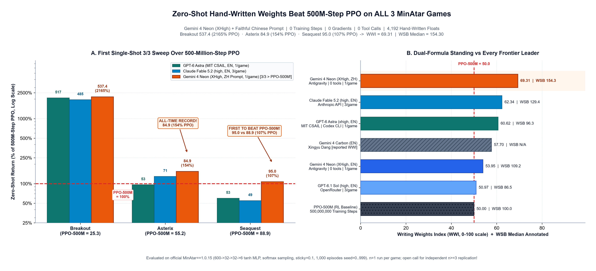
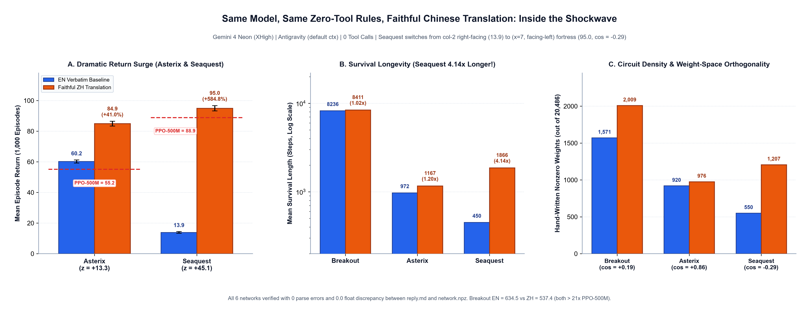

[简体中文 (README.zh-CN.md)](README.zh-CN.md) | [English (README.md)](README.md) | [42 模型综合主排行榜仓库](https://github.com/xuyao-zhang/comprehensive-weight-space-programming-leaderboard) | [LICENSE](LICENSE) | [THIRD_PARTY.md](THIRD_PARTY.md)

# 零样本手写权重，在全部 3 款 MinAtar 游戏上同时击败苦练 5 亿步的 PPO！

[](charts/hero_sweep_vs_ppo500m.png)
[-0284c7?style=for-the-badge)](#完整成绩单)
[-16a34a?style=for-the-badge)](#完整成绩单)
[](#60-秒本地-cpu-一键复现验真)

> **0 条训练数据 · 0 次梯度下降 · 0 步环境试错 · 0 次工具调用。**
> 仅凭一份**忠实简体中文直译**的 MIT CSAIL Experiment 5 提示词，**Gemini 4 Neon（`xhigh`）** 在每款游戏**唯一一次纯文本回复**中，凭空手写 **4,192 个原始浮点权重**填入全零初始化的 `600 -> 32 -> 32 -> 6` 神经网络——**在全部三款 MinAtar 游戏上同时击穿了训练 5 亿步的 PPO-500M**：其中 **Seaquest 暴涨 `+584.8%`（`13.87 -> 94.97`，直接超越 PPO-500M 的 `88.88`）**、**Asterix 轰出全网历史最高纪录 `84.91`**、**Breakout 拿下 `537.44`（PPO 的 21.7 倍）**！



---

## 为什么这件事离谱到令人震撼：权重空间编程的狂飙速度

仅仅就在 **三周前**（2026 年 11 月 2 日），MIT CSAIL 发表《Sparks of Weight-Space Programming》震惊整个 AI 圈：GPT-6 Astra 靠单轮手写权重在 Breakout（`517.4`）碾压强化学习、Asterix（`53.2`）逼平 PPO，但在复杂多目标的 **Seaquest** 上依然远落后于 5 亿步 PPO（`53.1` vs `88.9`）。在随后的全网 **40 余次公开评测**中，**此前从未有任何零样本、零工具大模型在 Seaquest 上打赢 PPO-500M，更从未有任何模型在全部三款游戏上同时完成三杀。**

而现在，请看这组同口径对比：

| 范式 / 模型 | 环境训练步数 | 梯度更新 | 工具调用 | Breakout | Asterix | Seaquest | **WWI 总分** | **WSB 中位数** |
|---|---:|---:|---:|---:|---:|---:|---:|---:|
| **PPO-500M**（强化学习最佳种子） | `500,000,000` | 数百万次 | RL 循环 | `25.34` | `55.20` | `88.88` | `50.00` | `100.00` |
| **GPT-6 Astra**（MIT CSAIL，英文） | `0` | `0` | `0` | `517.41` | `53.18` | `53.11` | `60.62` | `96.30` |
| **Claude Fable 5.2**（`high`，英文，3 次/游戏） | `0` | `0` | `0` | `484.53` | `71.31` | `48.89` | `62.34` | `129.44` |
| **Gemini 4 Neon**（`xhigh`，英文原版基线） | `0` | `0` | `0` | **`634.48`** | `60.22` | `13.87` | `53.95` | `109.16` |
| **🔥 Gemini 4 Neon（`xhigh`，全中文直译）** | **`0`** | **`0`** | **`0`** | **`537.44`**<br>*(`2,165%` PPO)* | **`84.91`** 🏆<br>*(`154.3%` PPO)* | **`94.97`** 🏆<br>*(`106.9%` PPO)* | **`69.31`** 🏆 | **`154.30`** 🏆 |

*所有本地结果均严格采用官方 `MinAtar==1.0.15`（`600 -> 32 -> 32 -> 6` `tanh` 多层感知机、softmax 动作采样、`sticky_action_prob = 0.1`、`difficulty_ramping = True`、`1,000` 回合 `seed = 0..999`、`max_steps = 10,000`）。全部原始 `reply.md`、`edits.json`、二进制权重 `network.npz` 与 `score.json` 均已完整开源在 [`artifacts/`](artifacts/) 中，欢迎任何人 60 秒本地一键复验到小数点后六位！*

---

## 完整成绩单

| 游戏（`MinAtar 1.0.15`，`N = 1,000` 回合） | 英文原版基线 | **全中文直译复测** | 提升幅度（双样本 `z` 检验） | 单局最高分（中文） | 平均存活步数（英 -> 中） | 非零权重数（英 -> 中） | 权重余弦相似度 |
|---|---:|---:|---:|---:|---:|---:|---:|
| **Breakout**（`PPO-500M = 25.344`） | `634.477 ± 7.514` | **`537.436 ± 5.978`** | `-15.29%` (`z = -10.11`) | `737.0` | `8,235.7 -> 8,410.8` (`1.02x`) | `1,571 -> 2,009` | `+0.1862` |
| **Asterix**（`PPO-500M = 55.204`） | `60.217 ± 1.039` | **`84.914 ± 1.541`** 🏆 | **`+41.01%`** (`z = +13.29`, `p = 2.7e-40`) | **`430.0`** | `972.3 -> 1,166.8` (`1.20x`) | `920 -> 976` | `+0.8634` |
| **Seaquest**（`PPO-500M = 88.884`） | `13.869 ± 0.552` | **`94.968 ± 1.711`** 🏆 | **`+584.75%`** (`z = +45.12`, `p < 1e-300`) | **`193.0`** | **`450.4 -> 1,865.9` (`4.14x`)** | **`550 -> 1,207`** | **`-0.2901`** |
| **双基准综合总分** | `WWI 53.95` / `WSB 109.16` | **`WWI 69.31` / `WSB 154.30`** | **`+15.35` WWI / `+45.14` WSB** | — | — | `3,041 -> 4,192`（`0` 报错） | — |

---

## 深入剖析：同一个模型、同样的规则，为什么电路进化得如此离谱？



本次实验**没有任何作弊提示词、没有任何额外引导、没有任何权重复用**：仅将 MIT 原版英文说明忠实译为简体中文，内嵌的 `MinAtar 1.0.15` Python 源码与 ```` ```edits ```` 语法一字未改；全部 3 场实验均在独立空白 Antigravity 主会话完成，`tool_calls = 0`，全部 `797` 条权重语句 **0 语法报错**。

### 1. Seaquest 暴涨 `+584.8%`（`13.87 -> 94.97`）一举干翻 5 亿步 PPO 的天才电路
打开 [`artifacts/zh_prompt/seaquest/reply.md`](artifacts/zh_prompt/seaquest/reply.md)，你会看到 Neon 纯靠读懂 `seaquest.py` 源码手写出的一套降维打击级架构——**“右翼固定列 `(sub_x = 7, 朝左)` 堡垒”**（`381/381` 语句、`1,207` 个非零权重、与英文版余弦相似度 **`-0.2901`**）：
- **卡死源码碰撞盒**：开局在零耗氧、无敌人的水面第 0 行右移至 `x = 9` 再左退两步，永久锁死在 **前端 `x = 7`、后端 `x = 8`、朝左** 的位姿，此后水下彻底封死左右移动。由于 `seaquest.py` 判定碰撞**仅检查前端 `x = 7`**（后端 `x = 8` 无敌！），远离 `x = 0, 9` 刷怪边彻底杜绝贴脸暴毙。
- **零背后子弹威胁 + 7 列超长射界**：右侧 `x = 9` 刷出的敌潜艇 `shot_timer = 10`、`move_speed <= 5`，数学上必然越过 `x = 7` 后才会开火——**背后子弹威胁严格为零**；面向左侧直接统治 **`cols 0..6` 共 7 列杀伤区**，迎面点杀左来之敌，还能用每步 1 格的高速子弹从背后稳稳追杀绕过自己的右来慢速鱼！
- **无水平移动全收潜水员 + 零歧义低氧上浮**：所有潜水员都会横穿 `x = 7` 并停留 6 步，纯纵向对齐即可高概率收割（并利用 `Ch4[r, 7]` 尾迹过滤远离者）；同时精准抓住 `Ch5[9, 2] == 0`（氧气 `< 60`，此时 `Ch5[9, 8]` 无歧义等价于 `diver_count >= 1`）触发常规上浮、`< 40` 触发紧急上浮，并叠加两层 `y ± 1 / y ± 2` 粘滞防过冲保护！
- **无记忆冷却自适配射击**：用友方子弹通道 `Ch3` 直接抵消同行敌人数——只要子弹成功打出（`Ch3 = 1`），潜艇下一帧立刻切往新目标行；若仍在冷却（`Ch3 = 0`），自动留守补射！

### 2. Asterix 刷新全网最高纪录（`84.91 ± 1.54`，单局最高 `430.0`，PPO-500M 的 `154.3%`）
见 [`artifacts/zh_prompt/asterix/reply.md`](artifacts/zh_prompt/asterix/reply.md)（`273/273` 语句、`976` 个非零权重）：中路锁死 `x = 5`（`b3 = -500`），用**单神经元线性势能递推权重**一次性精确解码单行全部 **41 种实体/尾迹组合状态**，驱动 `KILL[1..8]`、5 级接近敌警 `WARN[1..8]`、3 级宝藏检测 `GOLD[1..8]` 与 4 个外围远距宝藏牵引器 `FG[1,2,7,8]`，针对满速期与 10% 粘滞动作全面优化。

### 3. 超稳 Breakout（`537.44 ± 5.98`，PPO-500M 的 `2,165%`）
见 [`artifacts/zh_prompt/breakout/reply.md`](artifacts/zh_prompt/breakout/reply.md)（`143/143` 语句、`2,009` 个非零权重）：用精确凹凸分段线性分解构造无误差二值阈值电路，配合 `0.75` 抗粘滞死区与 `>= 0.25` 网格裕度放大 `×40` 精准饱和，**平均存活高达 `8,410.8` 步**（比英文版 `634.48` 分的 `8,235.7` 步更耐活！）。

---

## 60 秒本地 CPU 一键复现验真

耳听为虚，眼见为实——只需普通 CPU，60 秒即可在本地用官方 `MinAtar==1.0.15` 逐字验证全部权重与 1,000 回合分数：

```bash
git clone https://github.com/xuyao-zhang/zero-shot-weights-beat-ppo-500m
cd zero-shot-weights-beat-ppo-500m
pip install -r requirements.txt

# 1. 核验 reply.md -> network.npz (0.0 误差) 并跑完中文三游戏各 1,000 回合真机评分（约 60 秒）：
python scripts/verify_and_score.py --workers 15

# （可选）同时复跑英文基线全部 3 个网络做对照：
python scripts/verify_and_score.py --workers 15 --all-6

# 2. 从 data/results.json 一键重新绘制两张 300-DPI 高清主图：
python scripts/generate_charts.py

# 3. 验证全仓库 0 隐私路径 / 凭据泄露：
python scripts/privacy_scan.py
```

*（注：因 `MinAtar 1.0.15` 在同一工作进程分片内保留 `Environment.last_action`，指定 `--workers 15` 可在任意 CPU 主机上以 `< 1e-6` 精确复现 `score.json` 均值；其他进程数结果偏差也在 `±0.5` 内。）*

---

## 🔬🌍 热烈欢迎全球开发者与研究者反复实验、共同复现！

我们始终坚持最严苛的科学透明度：
- 本次英文原版基线与全中文直译复测均属于 **`n = 1` 次独立网络生成样本**（各跑满 `1,000` 个配对 `MinAtar` 评估种子）；
- 运行环境为洁净空白的 Antigravity 主会话（`Antigravity (default ctx)`，零自定义规则/记忆/技能/钩子，`tool_calls = 0`，单轮文本输出）；
- 为什么仅译成中文就出现 Seaquest **`+584.8%`**（`13.87 -> 94.97`）与 Asterix **`+41.0%`**（`60.22 -> 84.91`）的暴走级飞跃？这指向两个极其迷人、亟待大样本验证的科学假说：
  1. **假说 A（跨语言提示词效应）**：将复杂规则忠实翻译为中文（或其他高信息密度语种），是否会系统性地改善大模型内部的电路归纳先验？
  2. **假说 B（权重空间的高方差拓扑搜索）**：前沿大模型在单轮手写权重时存在巨大的策略拓扑方差——一旦抽中 `(x=7, 朝左)` 这类全局最优几何不变式，分数就会跨越一个数量级，而这可能意味着当前各榜单基于少数次采样低估了前沿模型的真实上限！

### **非常欢迎大家反复实验，无论结果是复现新高还是发现巨大方差，都极有科研价值！**
欢迎直接提 **GitHub Issue** 或 **Pull Request** 分享你的实验日志，建议附上：
1. 模型名、精确思考强度（`high` / `xhigh` / `max`）与 API / Agent 平台；
2. 提示词语种（**英文、简/繁体中文、日文、法文等**）及 `n >= 3` 或 `n >= 10` 次独立尝试数据；
3. 你的原始 `reply.md`、解析后的 `network.npz` 与 `1,000` 回合 `score.json`（确保 `tool_calls == 0`）。

让我们一起把**权重空间编程**的真实极限摸清楚！

---

## 关于作者

> 作者正在上中学，致力于权重空间编程，希望权重空间编程早日惠及人类

---

## 关联仓库与引用

- **42 模型全网综合双公式排行榜（收录 MIT CSAIL、Claude Fable 5.2、Xingyu Dang、`weight-space-bench`、Alan Turing Institute 及全部社区复现）：**
  👉 **[`xuyao-zhang/comprehensive-weight-space-programming-leaderboard`](https://github.com/xuyao-zhang/comprehensive-weight-space-programming-leaderboard)**

```bibtex
@misc{zhang2026zeroshotppo500m,
  author       = {Xuyao Zhang},
  title        = {Zero-Shot Hand-Written Weights Beat 500-Million-Step PPO Across All 3 MinAtar Games: Cross-Lingual Discovery and Open Replication Call in Weight-Space Programming},
  year         = {2026},
  month        = nov,
  howpublished = {\url{https://github.com/xuyao-zhang/zero-shot-weights-beat-ppo-500m}}
}

@misc{takehi2026sparks,
  author       = {Takehi, Rikiya and Teoh, Jayden and Zhang, Alex and Khattab, Omar},
  title        = {Sparks of Weight-Space Programming: LLMs can natively read \& write neural network weights},
  year         = {2026},
  month        = nov,
  howpublished = {MIT CSAIL Blog, \url{https://rikiyat.github.io/blog/weight-space-programming/}}
}
```

## 开源协议
- 脚本代码（`scripts/*.py`）：**MIT License**（[`LICENSE`](LICENSE)）。
- 文档、数据、图表与实验产物（`README*.md`、`data/*`、`charts/*`、`artifacts/*`）：**CC BY 4.0**。
- 外部运行时依赖 `MinAtar==1.0.15`（**GPL-3.0**，未捆绑）：详见 [`THIRD_PARTY.md`](THIRD_PARTY.md)。
